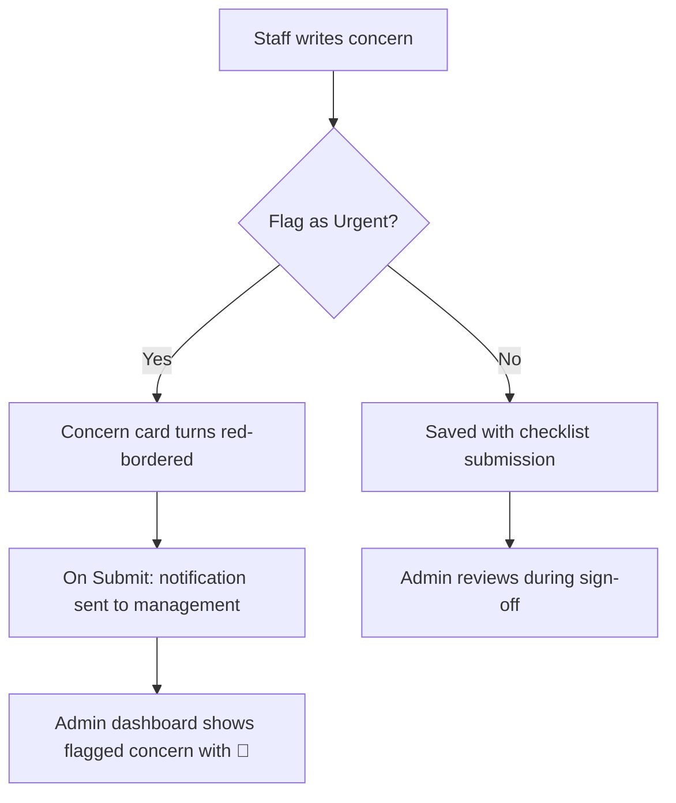

# SPCA Serving Allegany County — Cat Cleaning Checklist Page

## Design Plan

---

## 1. Overview

A **single-page, top-to-bottom scrolling checklist** that digitizes the existing paper-based cat cleaning forms used by SPCA Serving Allegany County. The primary users are **elderly employees and volunteers**, so every design decision prioritizes clarity, simplicity, and discoverability.

> [!IMPORTANT]
> **Core UX Principle: Nothing Hidden.**
> No dropdowns, no collapsible sections, no hidden menus, no tabs, no multi-page navigation. Everything is visible and scrollable. The scrollbar is always visible.

---

## 2. Color Palette

Derived from SPCA Serving Allegany County branding materials:

| Role | Hex | Usage |
|------|-----|-------|
| **Primary Warm** | `#b47a41` | Header background, section borders, primary buttons |
| **Primary Dark** | `#44423e` | Body text, headings |
| **Accent Orange** | `#d88627` | Flag/urgent badges, warning highlights |
| **Accent Teal** | `#5ea4ae` | Completed states, secondary buttons, success indicators |
| **Background** | `#faf8f5` | Page background (warm off-white) |
| **Card Background** | `#ffffff` | Section card fill |
| **Light Border** | `#e8e0d6` | Card borders, dividers |


---

## 3. Typography

- **Font**: System fonts for speed → `-apple-system, 'Segoe UI', Roboto, sans-serif`
- **Base size**: `18px` (larger than typical — elderly-friendly)
- **Checkbox label size**: `18px`
- **Section headings**: `24px`, bold, `#44423e`
- **Sub-headings**: `20px`, semi-bold
- **Line height**: `1.6` for readability

---

## 4. Layout Architecture

Single column, top-to-bottom. No sidebar. Generous padding. Always-visible scrollbar.

```
┌─────────────────────────────────────────────────────┐
│  HEADER  (SPCA logo right-aligned, page title left) │
├─────────────────────────────────────────────────────┤
│                                                     │
│  ┌───────────────────────────────────────────────┐  │
│  │  SECTION 0: Staff Info                        │  │
│  │  Employee/Volunteer: [___________]            │  │
│  │  Date: [auto-filled, editable]                │  │
│  └───────────────────────────────────────────────┘  │
│                                                     │
│  ┌───────────────────────────────────────────────┐  │
│  │  SECTION 1: Front Cats – Rooms Cleaning       │  │
│  │  ☐ Scoop/change litter boxes ...              │  │
│  │  ☐ Wipe down cubbies ...                      │  │
│  │  ☐ ... (all 11 checklist items)               │  │
│  └───────────────────────────────────────────────┘  │
│                                                     │
│  ┌───────────────────────────────────────────────┐  │
│  │  SECTION 2: Room Eating/Drinking Check        │  │
│  │  "Select all rooms where everyone ate/drank"  │  │
│  │  ☐ Room 1  ☐ Room 2  ☐ Room 3  ☐ Room 4     │  │
│  │  ☐ Room 5  ☐ Room 6  ☐ Room 7  ☐ Room 8     │  │
│  │  ☐ Playroom                                   │  │
│  └───────────────────────────────────────────────┘  │
│                                                     │
│  ┌───────────────────────────────────────────────┐  │
│  │  SECTION 3: Room Concerns                     │  │
│  │                                               │  │
│  │  [        Large text area for notes         ] │  │
│  │                                               │  │
│  │  Category:  ☐ Medical  ☐ Behavioral  ☐ Other │  │
│  │  ─────────────────────────────────────         │  │
│  │  ☐ 🚩 Flag for management                    │  │
│  │     Flagged concerns will notify management   │  │
│  └───────────────────────────────────────────────┘  │
│                                                     │
│  ┌───────────────────────────────────────────────┐  │
│  │  SECTION 4: Front Cats – Condos Cleaning      │  │
│  │  ☐ Remove cat(s) to playroom/hallway ...      │  │
│  │  ☐ Remove dirty bedding ...                   │  │
│  │  ☐ ... (all 9 checklist items)                │  │
│  └───────────────────────────────────────────────┘  │
│                                                     │
│  ┌───────────────────────────────────────────────┐  │
│  │  SECTION 5: Condo Eating/Drinking & Enrichment│  │
│  │  ☐ Did everyone in the condos eat/drink?      │  │
│  │  ☐ Did everyone get enrichment time?          │  │
│  └───────────────────────────────────────────────┘  │
│                                                     │
│  ┌───────────────────────────────────────────────┐  │
│  │  SECTION 6: Condo Concerns                   │  │
│  │                                               │  │
│  │  [        Large text area for notes         ] │  │
│  │                                               │  │
│  │  Category:  ☐ Medical  ☐ Behavioral  ☐ Other │  │
│  │  ─────────────────────────────────────         │  │
│  │  ☐ 🚩 Flag for management                    │  │
│  │     Flagged concerns will notify management   │  │
│  └───────────────────────────────────────────────┘  │
│                                                     │
│  ┌───────────────────────────────────────────────┐  │
│  │         [ ✅  SUBMIT CHECKLIST ]               │  │
│  │                                               │  │
│  │  (Large, full-width, high-contrast button)    │  │
│  └───────────────────────────────────────────────┘  │
│                                                     │
│  FOOTER (minimal — SPCA info)                       │
└─────────────────────────────────────────────────────┘
```

---

## 5. Component Details

### 5.1 Header
- **Left**: Page title — "🐱 Cat Cleaning Checklist"
- **Right**: SPCA Serving Allegany County logo (user will provide the image file)
- **Background**: `#b47a41` (warm brown)
- **Text**: White
- **Height**: ~70px, sticky at top so the user always sees it

### 5.2 Section 0: Staff Info Bar
- Sits directly below the header
- **Employee/Volunteer Name**: Simple text input, large font
- **Date**: Auto-filled to today's date (`YYYY-MM-DD`), but editable via a date picker in case they need to backfill
- Styled as a horizontal bar, light background `#f5f0ea`
- **Note**: "Signed off by" is NOT on this form — submission goes to an admin dashboard for sign-off (future feature)

### 5.3 Section Cards (Sections 1–6)
Each section is a **visible bordered card**:
- White background (`#ffffff`)
- `3px` solid left border in `#b47a41` (warm brown accent stripe)
- `1px` border on other sides in `#e8e0d6`
- `border-radius: 12px`
- `padding: 24px 28px`
- `margin-bottom: 24px`
- Subtle `box-shadow: 0 2px 8px rgba(0,0,0,0.06)`

**Section header** inside each card:
- Section title in `24px` bold `#44423e`
- A subtle reminder note below if applicable (e.g., "*All surfaces cleaned/disinfected with Rescue Cleaner daily*") in italic `#b47a41`

### 5.4 Checkbox Items
Each checklist item is a **large, tap-friendly row**:
- **Minimum height**: `52px`
- **Checkbox size**: `24px × 24px` (custom styled — not tiny browser default)
- **Label font**: `18px`, `#44423e`
- When checked: label gets a subtle `text-decoration: line-through` and color lightens to `#999`, checkbox fills with `#5ea4ae` (teal)
- Hover/focus: light background highlight `#f9f6f2`
- Each row has a bottom `1px` border in `#f0ebe4` to visually separate items

### 5.5 Room Multi-Select (Section 2)
- Prompt: **"Select all rooms where everyone ate and drank today:"**
- Grid of large toggle buttons (not small checkboxes)
- 4 columns on desktop, 2 on mobile
- Each button: ~`120px × 60px`, rounded corners
- **Unselected**: White with `#e8e0d6` border
- **Selected**: `#5ea4ae` background, white text, subtle checkmark icon
- Playroom button spans full width of its row to stand out

### 5.6 Concerns Section (Sections 3 & 6)
- **Text area**: Full-width, minimum `120px` tall, resizable, `18px` font, placeholder text "Note any concerns here..."
- **Category checkboxes**: Inline row — `☐ Medical` `☐ Behavioral` `☐ Other` — using the same large checkbox style
- **Thin divider line** between categories and the flag
- **Flag checkbox**: A standard large checkbox (same 24px style as all others) with label "🚩 Flag for management"
  - Uses accent orange `#d88627` for the checkmark fill instead of teal
  - Below it: small italic helper text in gray — *"Flagged concerns will notify management"* (always visible, not triggered)
  - **No card style changes** when flagged — the card looks identical regardless

### 5.7 Submit Button
- Full-width, `60px` tall
- Background: `#5ea4ae` (teal)
- Text: "✅ Submit Checklist" in `20px` bold white
- Hover: darkens to `#4e8f98`
- On submit: sends data to admin for "signed off by" review (future backend)
- Confirmation: A simple inline success message replaces the button — "✅ Submitted! Waiting for manager sign-off."

### 5.8 Always-Visible Scrollbar
```css
/* Force scrollbar to always be visible */
html {
  overflow-y: scroll;
  scrollbar-width: auto;        /* Firefox */
  scrollbar-color: #b47a41 #f0ebe4;  /* Firefox */
}

/* Webkit (Chrome, Safari, Edge) */
::-webkit-scrollbar {
  width: 14px;
}
::-webkit-scrollbar-track {
  background: #f0ebe4;
}
::-webkit-scrollbar-thumb {
  background: #b47a41;
  border-radius: 7px;
  border: 2px solid #f0ebe4;
}
```

---

## 6. Section Order & Rationale

The ordering mirrors the existing paper forms exactly, so staff don't need to re-learn:

| # | Section | Maps to Paper Form |
|---|---------|-------------------|
| 0 | Staff Info (name, date) | Bottom of paper → moved to top for digital |
| 1 | Front Cats – Rooms Cleaning | Rooms checklist items |
| 2 | Room Eating/Drinking | "Did everyone in ROOM X eat/drink?" (condensed to multi-select) |
| 3 | Room Concerns | "Please note any concerns..." + flag + categories |
| 4 | Front Cats – Condos Cleaning | Condos checklist items |
| 5 | Condo Eating/Drinking & Enrichment | Two yes/no questions |
| 6 | Condo Concerns | "Please note any concerns..." + flag + categories |
| — | Submit | Replaces "Signed off by" (goes to admin) |

---

## 7. Key UX Decisions for Elderly Users

| Decision | Rationale |
|----------|-----------|
| **Single scrolling page** | No tabs or page navigation to confuse users |
| **No dropdowns** | Everything is visible — checkboxes and toggle buttons only |
| **No collapsible/accordion sections** | All content is always visible |
| **Large text (18px base)** | Readability for older eyes |
| **Large checkboxes (24px)** | Easy to tap/click with reduced dexterity |
| **Always-visible scrollbar** | Clear affordance that there's more content below |
| **Line-through on checked items** | Immediately obvious what's done vs. not done |
| **High contrast text** | `#44423e` on `#faf8f5` — meets WCAG AA |
| **Auto-filled date** | One less thing to remember/type |
| **No required fields that block submission** | Gentle reminders, not hard blocks |
| **Simple visual hierarchy** | Bordered cards clearly separate sections |
| **Room buttons instead of 9 separate questions** | Reduces repetition, same information captured |

---

## 8. Flag & Notification Flow (Concerns)



- **Categories** (Medical / Behavioral / Other) help management filter and search concerns later
- **Flagging** is a visual toggle — hard to miss with the red styling
- Backend notification (email/dashboard alert) is a future feature but the UI supports it now

---

## 9. Tech Stack (Simple)

Since this is a simple draft/prototype:

| Layer | Choice | Reason |
|-------|--------|--------|
| Structure | HTML | Single `index.html` file |
| Styling | Vanilla CSS | Single `styles.css` file |
| Logic | Vanilla JS | Single `script.js` file — checkbox state, date auto-fill, flag toggle |
| Framework | None | Not needed for a checklist form |
| Build tools | None | Open `index.html` directly in browser |

Total: **3 files**. Dead simple.

---

## 10. File Structure

```
SPCA-cleaning/
├── design.md          ← This document
├── index.html         ← The checklist page
├── styles.css         ← All styles
├── script.js          ← Minimal interactivity
└── assets/
    └── spca-logo.png  ← User will provide
```

---

## 11. Future Considerations (Out of Scope for Now)

These came up in the conversation but are **not part of this cleaning checklist page**:

- **Admin sign-off dashboard** — where managers review and "sign off" completed checklists
- **Back Cats daily log** — individual cat logging across rooms (Maternity, Hold Rooms, Quarantine, etc.)
- **Condo Cats individual log** — 12 condos
- **Dog cleaning checklists** — similar forms for the dog side
- **Management notification system** — email/push alerts when a concern is flagged
- **Historical concern tracking** — searching past concerns for a specific cat (e.g., recurring limping)
- **Hallway cats / lobby cats** — additional location-based logs

These will be separate pages/features on the broader SPCA website.

---

## 12. Open Questions

1. **SPCA Logo file** — You mentioned you'll add the logo image. What format/filename should I expect?
2. **Submit destination** — For the draft, the submit button will just show a confirmation message. Is that okay, or do you want it to save to `localStorage` so the data persists?
3. **Mobile vs. Desktop** — Will this primarily be used on a **tablet**, **desktop computer**, or **phone**? This affects button sizes and layout breakpoints.
4. **Multiple submissions per day?** — Can the same person submit the Rooms checklist and Condos checklist at different times, or is it always one combined submission?
